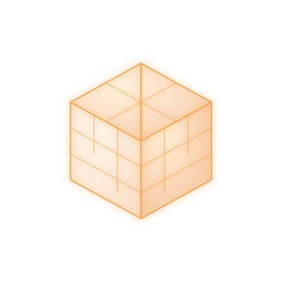

# For the Pursuit of Knowledge

 

  

  <em>A visualization of perpetual motion, interconnected knowledge, and continuous discovery.</em>

---

<table>
<tr>
<td width="40%" align="center">

### Vergil Dominance

The rotating sphere represents the pursuit of understanding through curiosity and exploration. Every line intersects with another, much like ideas, disciplines, and experiences converge to create knowledge.

</td>

<td width="60%">

Across every line of code, every experiment, and every challenge lies an opportunity to learn something new.

I'm a developer and lifelong learner with an interest in building systems that are reliable, useful, and thoughtfully designed. This GitHub profile is a collection of projects, explorations, and lessons learned while navigating software engineering, data, cloud technologies, and beyond.

**Here you'll find:**

- Projects built from curiosity
- Experiments driven by learning
- Solutions shaped by practical experience
- Ideas that continue to evolve

Knowledge is not a destination but a journey, and this repository is part of that journey.

</td>
</tr>
</table>

---

> *"The more I learn, the more I realize how much I have yet to discover."*
>
>  

  

  <em>A visualization of perpetual motion, interconnected knowledge, and continuous discovery.</em>

---

<table>
<tr>
<td width="40%" align="center">

### AshkaiK

The rotating sphere represents the pursuit of understanding through curiosity and exploration. Every line intersects with another, much like ideas, disciplines, and experiences converge to create knowledge.

</td>

<td width="60%">

Across every line of code, every experiment, and every challenge lies an opportunity to learn something new.

I'm a developer and lifelong learner with an interest in building systems that are reliable, useful, and thoughtfully designed. This GitHub profile is a collection of projects, explorations, and lessons learned while navigating software engineering, data, cloud technologies, and beyond.

**Here you'll find:**

- Projects built from curiosity
- Experiments driven by learning
- Solutions shaped by practical experience
- Ideas that continue to evolve

Knowledge is not a destination but a journey, and this repository is part of that journey.

</td>
</tr>
</table>

---

> *"The more I learn, the more I realize how much I have yet to discover."*

---

## Skills & Technologies

<table>
<tr>
<td valign="top" width="50%">

### Software Engineering

- Java
- Python
- C++
- SQL
- Git & GitHub
- Object-Oriented Programming
- Software Design Principles

</td>

<td valign="top" width="50%">

### Data & AI

- PostgreSQL
- Data Warehousing
- ETL Pipelines
- Data Analysis
- Machine Learning
- Deep Learning
- LSTM Networks
- Transformer Models

</td>
</tr>

<tr>
<td valign="top">

### Cloud & Infrastructure Technology

- Docker
- Snowflake
- SAP - HANA
- Databricks
- Dataiku
- Tableau
- Cloud Technologies
- Database Administration
- System Configuration

</td>

<td valign="top">

### Professional Skills

- Project Leadership
- Project Management
- Team Collaboration
- Technical Problem Solving
- Communication
- Research & Development

</td>
</tr>
</table>

---

## Featured Work

| Project | Description |
|----------|------------|
| **ESME** | Emotional Support eMpathy Emulator. AI chatbot leveraging LSTM and Transformer architectures for empathetic conversational responses. 【1-22d8bd】 |
| **Tier 3 Data Warehouse** | Enterprise data warehouse with AI/ML-powered predictive analytics and sales forecasting capabilities. |

---

## Achievements

- Research paper contributor to the **3rd International Conference on Data Analytics and Insights (ICDAI 2025)**. 【1-22d8bd】
- Online Safety Commission Champions Programme member. 【1-22d8bd】
- Multiple university volunteering awards and certificates. 【1-22d8bd】

---

> *"The more I learn, the more I realize how much I have yet to discover."*
